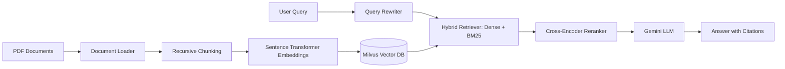

# 📄 Company Documents Q&A Bot (Multi-Document RAG)

A production-grade Retrieval-Augmented Generation (RAG) system built with **FastAPI**, **Milvus Vector Database**, **Sentence Transformers**, **Gemini LLM**, and **Streamlit**.

---

## 🌟 Key Features

- **Document Processing**: Ingest and process enterprise PDF documents with chunking and metadata preservation.
- **Hybrid Retrieval**: Combines BM25 keyword matching with dense vector similarity search in **Milvus**.
- **Cross-Encoder Reranking**: Re-scores candidate context chunks to ensure the most relevant content reaches the LLM.
- **Query Rewriting**: Context-aware query reformulation for accurate multi-turn conversation support.
- **Multi-Document & Specific-Document Filtering**: Ask questions across all ingested knowledge or restrict queries to specific document IDs.
- **Interactive UI**: Streamlit web interface with real-time Q&A, source citation, document switcher, and conversation history.
- **FastAPI Backend**: High-performance RESTful API endpoints for ingestion, search, querying, and health monitoring.
- **Evaluation Pipeline**: Automated RAG evaluation benchmark with retrieval accuracy and response generation metrics.

---

## 🏗️ Architecture



---

## 📁 Project Structure

```
Company_Docs_QA_Bot/
├── app/
│   ├── bm25_retriever.py     # BM25 sparse keyword retriever
│   ├── chunking.py           # Document chunking logic
│   ├── config.py             # Configuration and environment settings
│   ├── document_loader.py    # PDF parsing and extraction
│   ├── embeddings.py         # Embedding generation
│   ├── llm.py                # Gemini LLM integration
│   ├── main.py               # FastAPI application & endpoints
│   ├── query_rewriter.py     # Contextual query reformulation
│   ├── reranker.py           # Cross-encoder reranking
│   ├── retriever.py          # Unified hybrid retrieval pipeline
│   └── vector_store.py       # Milvus collection management & search
├── data/                     # Sample company PDF documents
├── evaluation/
│   ├── evaluation.py         # RAG evaluation script
│   └── evaluation_questions.json # Benchmark questions & ground truths
├── docker-compose.yml        # Milvus standalone service definition
├── standalone.bat            # Script to run Milvus standalone
├── streamlit_app.py          # Streamlit frontend user interface
├── ingest.py                 # CLI document ingestion script
├── create_pdfs.py            # Utility to generate test PDFs
├── requirements.txt          # Python dependencies
├── .env.example              # Sample environment variables
└── README.md                 # Project documentation
```

---

## 🚀 Getting Started

### 1. Prerequisites

- Python 3.10+
- Docker & Docker Compose (for Milvus standalone)

### 2. Setup Virtual Environment

```bash
python -m venv venv
# Windows:
.\venv\Scripts\activate
# Linux/macOS:
source venv/bin/activate

pip install -r requirements.txt
```

### 3. Configure Environment Variables

Copy the example environment file and set your credentials:

```bash
cp .env.example .env
```

Edit `.env`:
```env
GEMINI_API_KEY=your_gemini_api_key_here
MILVUS_HOST=localhost
MILVUS_PORT=19530
```

### 4. Start Milvus Vector Database

Using Docker Compose:
```bash
docker-compose up -d
```

*(Alternatively on Windows, use `standalone.bat start`)*

### 5. Ingest Sample Documents (Optional)

```bash
# Generate sample PDFs
python create_pdfs.py

# Ingest PDFs into Milvus
python ingest.py
```

### 6. Run the Application

Start the **FastAPI backend**:
```bash
uvicorn app.main:app --reload --port 8000
```

In a separate terminal, start the **Streamlit frontend**:
```bash
streamlit run streamlit_app.py
```

Open your browser at `http://localhost:8501`.

---

## 📊 Evaluation

To run automated RAG evaluation:
```bash
python -m evaluation.evaluation
```
